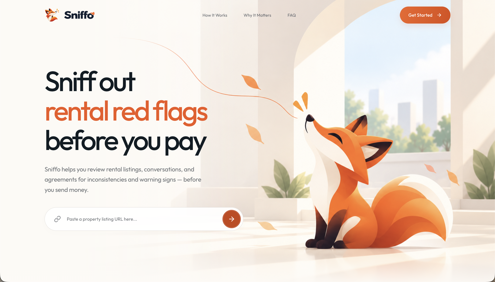

# Sniffo

<p align="center">
  
</p>

<p align="center"><strong>AI-powered rental research and evidence review</strong></p>

> **Beta / Hackathon Prototype** · Built by a three-person team during U-Hackathon in October 2026. The limited hackathon timeframe shaped the scope: core review flows are functional, while some AI-assisted and research features remain experimental, partially implemented, or incomplete. Sniffo is an unhosted prototype, not a production-ready service.

Sniffo brings rental listing details and landlord conversations into one review. It helps renters compare submitted information, inspect supported inconsistencies and warning signs, and understand what the available evidence does not establish.

## The idea

Rental decisions often depend on details spread across listings, messages, payment requests, and agreements. Sniffo explores how those details can be brought together with clear evidence and uncertainty, instead of reducing the review to an unexplained score.

## Key features

- **Rental detail review:** extract details from supported public listing pages or enter them manually.
- **Cross-source comparison:** compare details such as rent, deposits, dates, room type, address, and payment recipient across submitted information.
- **Evidence-backed findings:** surface selected inconsistencies and payment or message warning signs with supporting quotations and source references.
- **Coverage and uncertainty:** show missing information and explain what Sniffo could not verify; missing details alone are not treated as proof of fraud.
- **A complete review flow:** guide users through listing details, landlord messages, and a results report with evidence and suggested next steps.
- **Optional AI-assisted capabilities:** provide bounded extraction, review, public search, and image-comparison paths when explicitly enabled and configured.

Text-based and deterministic checks work without provider credentials. AI and research options are disabled in the example configuration. When enabled, they may send submitted content to the configured provider. Review provider data practices before using those options.

## Review flow

1. Start with a public listing URL or enter the property details manually.
2. Review and correct those details, add landlord messages, and choose whether to request optional Deep Research.
3. Read findings alongside their supporting evidence, coverage limits, and suggested next steps.

## Technical highlights

- SSRF-aware URL retrieval with DNS validation, pinned IPv4 connections, redirect revalidation, and request limits.
- Evidence integrity checks that preserve the distinction between server-extracted information and user assertions.
- Typed API contracts shared across the React client, Express API, and workspaces using Zod.
- A rule-based concern indicator that requires sufficient evidence and is explicitly not a probability of fraud.
- Optional AI and research integrations with bounded requests and provider features disabled by default in the shipped example.

These are prototype safeguards and engineering choices; they do not amount to a production security assessment.

## Current scope and limitations

Sniffo was developed under a short hackathon schedule. The main manual-entry, analysis, and report journey is implemented, and the repository includes unit and browser tests. Some supporting capabilities are still evolving:

- Listing extraction depends on what a source page makes available and can be blocked or change over time. Manual entry remains available.
- The primary interface accepts pasted landlord messages. The API supports text and selected file evidence ingestion, but the main interface does not currently offer a file-upload control.
- AI-assisted extraction, review, Deep Research, public search, and image comparison are optional paths that need provider configuration. They are not a guarantee of complete or correct results.
- Reports are held in browser session storage; the API does not persist analyses. There are no user accounts, hosted demo, or deployment configuration.
- The app does not establish whether a person owns a property, has authority to rent it, or whether the property is safe. Findings may be incomplete or wrong and should be checked independently.

Do not use real identity documents, payment credentials, or other sensitive personal information when testing the prototype.

## Technology

| Area             | Stack                                                           |
| ---------------- | --------------------------------------------------------------- |
| Web              | React 19, TypeScript, Vite, Tailwind CSS v4, React Router, GSAP |
| API              | Node.js, Express 5, TypeScript, Zod                             |
| Shared contracts | npm workspaces and Zod schemas                                  |

```text
apps/web/        React application and API client
apps/api/        Express API, routes, middleware, and services
packages/shared/ Shared request/response schemas and types
```

## Run locally

**Requirements:** Node.js 22 LTS and npm 10 or newer.

```bash
git clone https://github.com/coderm1ntyx/sniffo.git
cd sniffo
npm ci
cp apps/api/.env.example apps/api/.env
cp apps/web/.env.example apps/web/.env
npm run dev
```

Open <http://localhost:5173>. The API listens on <http://127.0.0.1:3001> by default, and Vite proxies `/api` requests to it. Provider keys are optional for local development; add them only to the API's ignored `.env` file when you intentionally enable a provider.

### Useful commands

```bash
npm run dev          # Run the web app and API
npm run dev:web      # Run only the web app
npm run dev:api      # Run only the API
npm test             # Run shared, API, and web unit tests
npm run typecheck    # Type-check all workspaces
npm run lint         # Run ESLint
npm run build        # Build all workspaces
```

## Environment variables

The API loads `apps/api/.env`; the web app loads `apps/web/.env`. Local `.env` files are ignored by Git. Never place server credentials in a `VITE_*` variable because Vite includes those values in browser code.

| Variable                                                              | Used by | Purpose                                                                                                                                   |
| --------------------------------------------------------------------- | ------- | ----------------------------------------------------------------------------------------------------------------------------------------- |
| `NODE_ENV`, `HOST`, `PORT`, `CORS_ORIGIN`                             | API     | Runtime and allowed frontend origin. The example uses local development values.                                                           |
| `EVIDENCE_SIGNING_SECRET`                                             | API     | Optional in local development; production mode requires a private random value of at least 32 characters.                                 |
| `OPENAI_API_KEY`, `OPENAI_MODEL`                                      | API     | Optional scanned-document extraction, AI review, and OpenAI search. Keep the key server-side.                                             |
| `GOOGLE_CLOUD_VISION_API_KEY`                                         | API     | Optional image-search integration.                                                                                                        |
| `ELEVENLABS_TTS_ENABLED`, `ELEVENLABS_API_KEY`, `ELEVENLABS_VOICE_ID` | API     | Optional report narration, disabled unless explicitly enabled.                                                                            |
| `DEEP_RESEARCH_*`                                                     | API     | Optional public search and image comparison. Search and Vision are disabled in the example; Vision may incur provider costs when enabled. |
| `VITE_API_URL`                                                        | Web     | Optional API origin for a separately hosted API. Leave empty to use the local Vite proxy.                                                 |

See [`apps/api/src/config/env.ts`](apps/api/src/config/env.ts) for supported limits and optional settings. Do not commit real credentials. If a credential is exposed, revoke or rotate it with its provider.

## API overview

- `GET /api/health` — service health
- `POST /api/extract/url`, `/api/extract/text`, `/api/extract/file` — ingest supported evidence
- `POST /api/online-checks` — optional public image or claim checks
- `POST /api/analyze` — compare evidence and return findings

## Hackathon

Sniffo was developed by a three-person team during U-Hackathon in October 2026. Within the limited event timeframe, the team shaped a rental-safety idea into a working web experience, API, evidence review flow, and test suite. The prototype reflects collaborative product research, interface design, backend engineering, and rapid problem-solving.

## Team & Contributions

- **Luka** ([coderm1ntyx](https://github.com/coderm1ntyx)) — Full-stack development across the frontend and backend, system architecture, and technical implementation. The project history includes the React application, API foundation, shared contracts, evidence review, and report experience.
- **Raymit** ([raymeses](https://github.com/raymeses)) — Backend development, technical research, and implementation support, including work supporting the API and the project’s development workflow.
- **Jennifer** — Core team member responsible for research, idea development, presentation design, pitch deck creation, content writing, and communicating the project’s purpose and potential impact.

## Privacy and legal notes

This repository describes a local prototype; it does not provide a hosted service or user accounts. A standalone privacy policy or terms of service is not included because there is no hosted user relationship to describe. Optional provider integrations may send submitted content to those providers when enabled. Reassess privacy notices, terms, and applicable legal requirements before offering a hosted service.

## License

Sniffo is provided under the MIT License. See [`LICENSE`](LICENSE).
